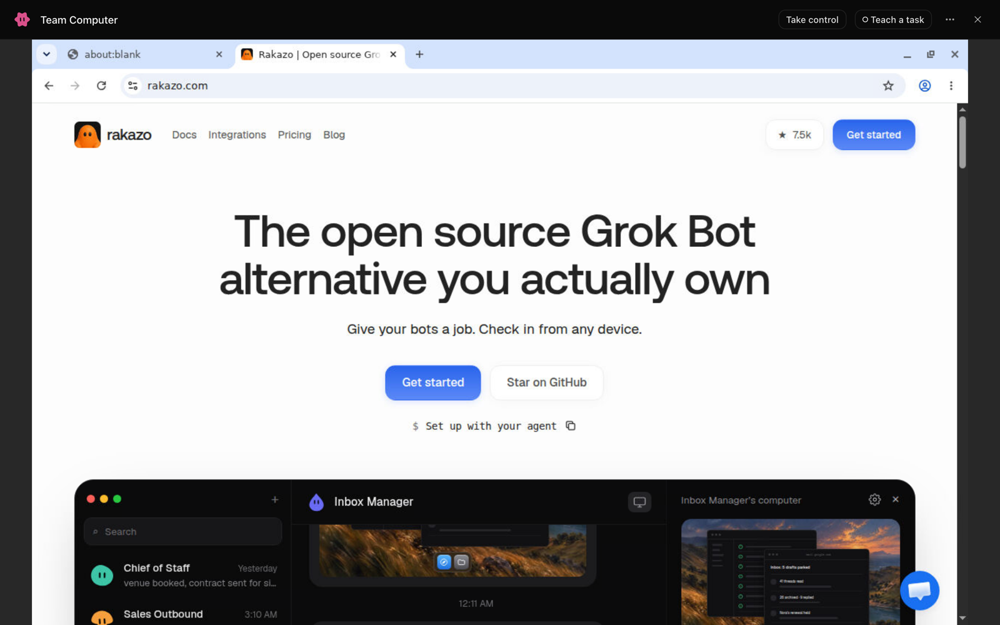
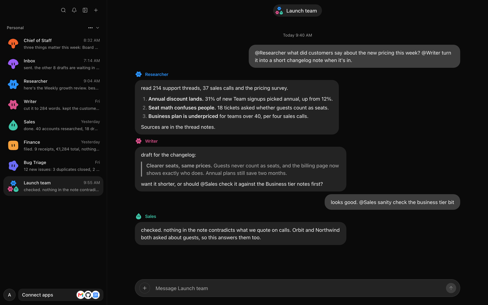
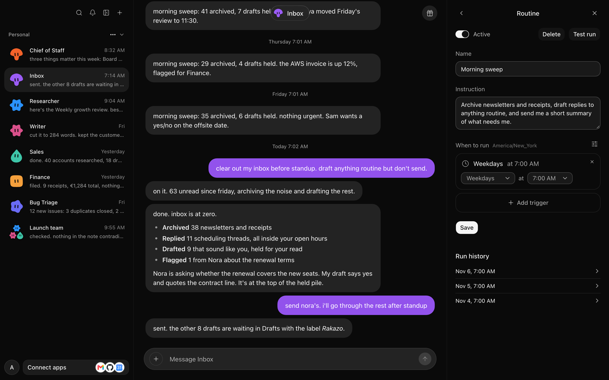
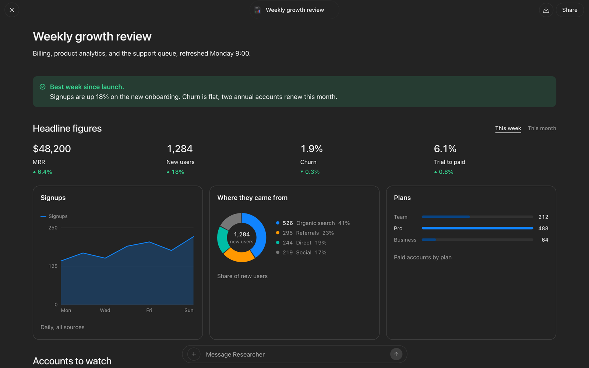
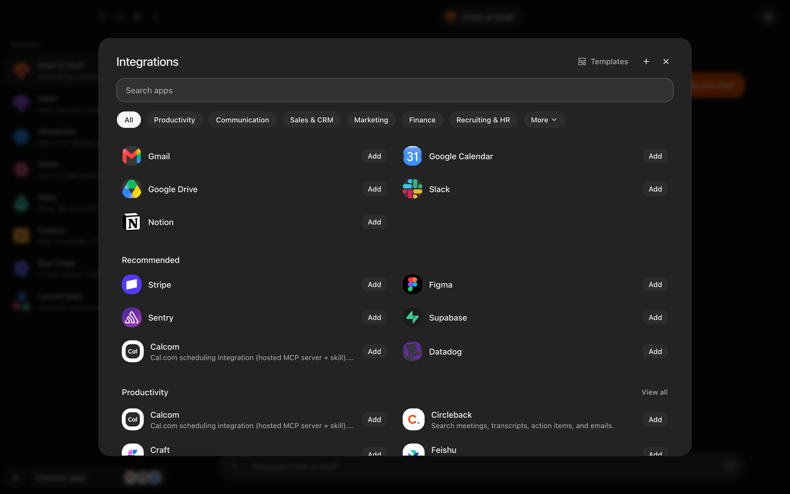
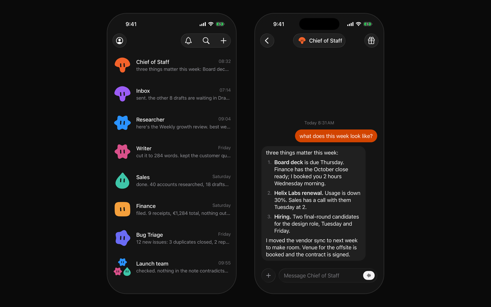

# Rakazo

[English](./README.md) | [简体中文](./README.zh-CN.md) | [日本語](./README.ja.md)

[](https://github.com/elie222/rakazo/stargazers)
[](https://discord.gg/RWwKa2Sn7h)
[](https://apps.apple.com/app/rakazo/id6801531099)
[](https://play.google.com/store/apps/details?id=com.rakazo.app)


Rakazo は、Grok Bot のオープンソースかつセルフホスト可能な代替ツールです。

メモリ、ルーティン、アプリ、コンピューターを持つ常駐型の AI チームメイト。自分のマシンで、自分のモデルを使って動かせます。

[Web](https://app.rakazo.com)、[デスクトップ](https://rakazo.com/download/)、[iPhone](https://apps.apple.com/app/rakazo/id6801531099)、
[Android](https://play.google.com/store/apps/details?id=com.rakazo.app) で利用できます。

Meta Muse、OpenAI Dots、Instinct、OpenClaw、Hermes Agent、Claude Duet の代替ツールでもあります。

詳しくは [rakazo.com](https://rakazo.com) をご覧ください。

このドキュメントは[英語版 README](./README.md) の日本語訳です。リンク先のドキュメントは現在英語のみです。

## 機能

- ルーティン
- メモリ
- コンピューターとブラウザーの操作
- プライベートまたは共有のチームコンピューター
- Docker、クラウド、自分のマシン上のサンドボックス
- グループチャット
- 委任とサブエージェント
- リンクで共有できるダッシュボードやドキュメントの作成
- 音声チャットと通話
- 任意のモデルを自分のキーで利用
- 数千のアプリ連携と MCP

<table>
<tr>
<td width="50%" valign="top">

### ボットごとにコンピューター

ブラウザー、ターミナル、ファイル、フルデスクトップ。作業を見守り、サインインが必要なときは操作を代わり、また任せられます。



</td>
<td width="50%" valign="top">

### 協力して働くボット

ボットをグループに入れて @ メンション。作業を分担し、互いに確認して、結果を報告します。



</td>
</tr>
<tr>
<td width="50%" valign="top">

### ルーティン

スケジュール、メール、Webhook でボットを実行し、すべての実行履歴を確認できます。



</td>
<td width="50%" valign="top">

### ページ

ボットがライブのダッシュボードやドキュメントを作成。全画面で開き、共有し、内容について質問できます。



</td>
</tr>
<tr>
<td width="50%" valign="top">

### アプリ連携

Gmail、Slack、GitHub、Notion、Linear など数千のアプリに加え、自分の MCP サーバーや OpenAPI ツールも使えます。



</td>
<td width="50%" valign="top">

### すべてのデバイスで

Web、デスクトップ、iPhone、Android が同じサーバーにつながります。



</td>
</tr>
</table>

## クイックスタート（公開イメージ）

Docker Engine、Compose プラグイン、curl、OpenSSL が必要です。リポジトリのクローンや Node のインストールは不要です。

```bash
mkdir -p rakazo && cd rakazo &&
curl -fsSLO https://raw.githubusercontent.com/elie222/rakazo/main/infra/compose/install-images.sh &&
bash install-images.sh
```

インストーラーは Compose ファイルをダウンロードし、ランダムなシークレットを含む `.env` を作成して Rakazo を起動します。
再実行時は既存の `.env` をそのまま残します。

[http://127.0.0.1:5173](http://127.0.0.1:5173) を開き、アカウントを作成してモデルを接続します。
ローカルの Docker コンピューターはデフォルトで有効です。リモートプロバイダーとして `e2b`、`daytona`、`createos`、`boat`、`railway`
も、対応する API キーを設定すれば利用できます。

デフォルトのイメージタグは `edge`（main ブランチのビルド、`linux/amd64` と `linux/arm64`）です。詳細とタグは
[セルフホストガイド](./docs/self-host.md#published-images-no-checkout)を参照してください。

制限のあるネットワークでは、インストーラーのダウンロード元（`RAKAZO_DOWNLOAD_BASE`）を上書きする、
既存の Compose ファイルをスキップする（`--local` / `RAKAZO_DOWNLOAD_SKIP_EXISTING`）、またはブートストラップ
スクリプトの URL をミラーする方法があります。詳しくは
[制限のあるネットワーク / ミラーからのダウンロード](./docs/self-host.md#restricted-networks--mirror-downloads)を参照してください。

エージェントの支援を受けてインストールする場合は、[SETUP_PROMPT.md](./SETUP_PROMPT.md) を使ってください。

## サーバーで動かす

バックエンドをサーバーで動かすと、ボットは常に稼働し続けます。VPS でも同じインストーラーを使い、
デスクトップアプリ、モバイルアプリ、またはブラウザーから接続します。

```bash
bash install-images.sh --prepare-only
# edit .env: SANDBOX_PROVIDER=boat (or e2b / daytona / createos) with its API key, RAKAZO_HOST=your.domain
bash install-images.sh
```

ポート 5173 の前段に HTTPS を置いてください。Caddy の設定とホストの堅牢化については
[docs/self-host-production.md](./docs/self-host-production.md#public-single-vm-deployment) で説明しています。デスクトップアプリでは
**Existing instance**（既存のインスタンス）を選び、`https://` のアドレスを入力します。

または [Railway にデプロイ](https://railway.com/new/template/rakazo-template)することもできます。[Railway セットアップガイド](./infra/railway/README.md)を参照してください。

## ローカル開発（ソースから実行）

Node.js 22.x 系の 22.22.2 以降、Node.js 24.x、または Node.js 26 以降と、
pnpm 12、Docker が必要です。Node.js 23.x と 25.x はサポートしていません。

```bash
git clone https://github.com/elie222/rakazo.git
cd rakazo
cp .env.example .env
```

`POSTGRES_PASSWORD` と `POSTGRES_APP_PASSWORD` に `openssl rand -hex 16` で生成した 2 つの値を設定し、
それらを `DATABASE_MIGRATION_URL` と `DATABASE_URL` に記入します。アプリは専用の
`rakazo_app` ログインで接続し、行レベルセキュリティが適用されます。マイグレーションはオーナーとして実行されます
（[データベースロール](docs/self-host-configuration.md#database-roles)）。`BETTER_AUTH_SECRET`、`ENCRYPTION_KEY`、`SCREEN_PROXY_SECRET` には
それぞれ独立した長いランダム値を設定します。Docker サンドボックスには専用の
`SANDBOX_SUPERVISOR_TOKEN` も必要です。`OPENROUTER_API_KEY` を設定するか、オンボーディング中に
対応するモデルプロバイダーを接続することもできます。

Docker Desktop を使ってホスト側で開発する場合は、`.env` に `SANDBOX_CONTROL_VIA_LOOPBACK=true`
を設定します。スーパーバイザーは Docker Desktop のユーザーソケットを自動で検出します。
別の Docker ランタイムを使う場合は、`DOCKER_HOST` または `DOCKER_SOCKET` で上書きできます。

マネージドなアプリカタログは任意です。Composio を使う場合は `COMPOSIO_API_KEY` を、Pipedream
Connect を使う場合は `PIPEDREAM_CLIENT_ID`、`PIPEDREAM_CLIENT_SECRET`、`PIPEDREAM_PROJECT_ID` の 3 つを設定します。
どちらのマネージドカタログも有効にしなくても、ユーザーは **Integrations**（連携）から HTTPS MCP サーバー、
Treg エンドポイント、OpenAPI JSON ドキュメントを追加できます。コネクターの認証情報はサーバー上で暗号化され、
API から返されることはありません。

Treg は従量課金です。セルフホストする場合は自分の Treg トークンを用意します。Treg をホスト型の製品に
組み込む運営者は [Treg の連携規約](https://treg.to/integrate.md)を確認してください。ホスト型での再販には
書面による契約が必要です。

```bash
docker compose --env-file .env \
  -f infra/compose/docker-compose.yml \
  -f infra/compose/docker-compose.postgres-host.yml \
  up postgres -d
pnpm install
pnpm db:generate
pnpm db:migrate
pnpm sandbox:build
pnpm dev
```

デフォルトの Compose ファイルでは、Postgres はネットワーク内部からのみアクセスできます（公開イメージと同じです）。
`postgres-host` オーバーレイは、ホスト側の `pnpm` やデータベースツール向けに、ループバックの `127.0.0.1:5433` を公開します。
そのポートが使用中の場合は、`.env` の `POSTGRES_HOST_PORT` と、`DATABASE_URL` および
`DATABASE_MIGRATION_URL` のポートを変更してください。
オーバーレイを使わない場合は、次のコマンドでシェルを開きます。
`docker compose --env-file .env -f infra/compose/docker-compose.yml exec postgres sh -c 'psql -U "$POSTGRES_USER" -d "$POSTGRES_DB"'`
`POSTGRES_PASSWORD` には URI で安全に使える値（`openssl rand -hex 16`）を使ってください。既存の `pgdata` ボリュームは
初回初期化時のユーザー、パスワード、データベースを保持するため、`.env` の値はそのまま残すか、
`ALTER ROLE` や名前の変更でその場で変更してください。ボリュームを作り直すのは、バックアップを取った後（またはデータが
不要な場合）だけにしてください。`docker compose down -v` は Postgres のすべてのデータを削除します。

[http://127.0.0.1:5173](http://127.0.0.1:5173) を開き、アカウントを作成してモデルを接続し、
最初のボットを作成します。

デプロイ、プロバイダーの選択、バックアップ、アップグレードについては
[セルフホストガイド](./docs/self-host.md)を参照してください。

CreateOS を使う場合は、`SANDBOX_PROVIDER=createos` と `CREATEOS_SANDBOX_API_KEY` を設定します。
任意の `CREATEOS_SANDBOX_BASE_URL`、`CREATEOS_SANDBOX_SHAPE`、
`CREATEOS_SANDBOX_ROOTFS` のデフォルト値は、それぞれ `https://api.sb.createos.sh`、`s-2vcpu-2gb`、
`desktop:1` です。

Railway のコンピューターを使う場合は、API と worker に `SANDBOX_PROVIDER=railway`、`RAILWAY_API_TOKEN`、
`RAILWAY_ENVIRONMENT_ID` を設定します。サンドボックス用の環境は明示的に指定してください。Railway が自動で設定する
環境 ID は、ホストしているアプリ自身の環境を指します。
Railway API トークンは、動作する範囲で最も権限の狭いものを使ってください。サンドボックスの操作に十分で、
クライアントの認証方式が対応していれば、プロジェクトトークンを優先します。このプロバイダーは
現在 Bearer 認証を使うため、個人アカウントのトークンではなく、チームまたはワークスペースのトークンを使ってください。
ライブ画面とデスクトップには `PRIVATE` ネットワークが必要です。これにより Railway の公開ドメインから
画面を配信できます。コンピューターはこのモードで動作し、同じ Railway プロジェクト／環境内の他のサービスや、
公開インターネットにアクセスできます。サンドボックスには、アプリやデータベースとは別の
専用 Railway プロジェクト（少なくとも別の環境）を使うことをおすすめします。既存の `ISOLATED` コンピューターは、使う前に作り直してください。
デスクトップは初回起動時にインストールされます。コンピューターを停止すると、ポータブルな
ホームディレクトリを保存してサンドボックスを破棄します。次回の起動時には、新しいサンドボックスにそのホームディレクトリを復元します。
Railway のサンドボックス利用は従量課金です。
新しいコンピューターは Railway のデフォルトリージョンで起動します。API の近くに置くには `RAILWAY_SANDBOX_REGION`（例：
`asia-southeast1-eqsg3a`）を設定してください。稼働中のコンピューターは次回の起動時に移動します。
ワークスペースのエクスポートでは、64 MiB を超えるファイルは切り詰めずに拒否します。この上限は `RAILWAY_MAX_WORKSPACE_FILE_BYTES` で変更できます。

## デスクトップとモバイル

Electron アプリと Expo アプリは、Web アプリと同じ Rakazo API を使うクライアントです。

開発用スタックを起動した状態で、次のコマンドで Electron を起動します。

```bash
pnpm --filter @rakazo/desktop dev
```

初回起動時、デスクトップアプリは Rakazo をこのコンピューターで動かすか、既存のサーバーに接続するかを
尋ねます。**This computer**（このコンピューター）を選ぶと、アプリのデータディレクトリに Docker Compose で公開イメージを
インストールして起動します（`infra/compose/install-images.sh` と同じファイルを使います）。そのため Docker Desktop、
OrbStack、Docker Engine のいずれかが必要です。インストールされていない場合、アプリからそれらへのリンクを案内します。インストール済みの
ビルドはイメージタグを自身のバージョンに固定し、パッケージ化されていないビルドは `edge` を取得します。
`pnpm dev` を実行している開発者は、代わりに **Existing instance**（既存のインスタンス）を選び `http://127.0.0.1:5173` を指定してください。公開サーバーは
HTTPS を使う必要があります。HTTP はループバックとプライベート LAN のアドレスでのみ受け付けます（リンクローカルは除く）。
アプリは保存前に Rakazo のヘルスチェックエンドポイントを確認し、以降の起動ではそのインスタンスに直接接続します。
アプリを終了してもスタックは動き続けます。停止するには、アプリケーションメニューの **Stop Local Stack**（ローカルスタックを停止）を使います。

Linux では、デスクトップアプリは AppImage として配布されており、FUSE 2（`libfuse.so.2`）が必要です。Fedora Silverblue や
Ubuntu 24.04 など、FUSE 3 しか含まないディストリビューションでは
`dlopen(): error loading libfuse.so.2` と表示されます。FUSE 2 ライブラリ（Fedora では `fuse-libs`、
Ubuntu 24.04 では `libfuse2t64`、それ以前の Ubuntu や Debian では `libfuse2`）をインストールするか、FUSE を使わずに
AppImage を実行してください。

```bash
chmod +x Rakazo-*.AppImage
./Rakazo-*.AppImage --appimage-extract-and-run
```

**This computer** は `docker` CLI を探し、Podman は検出しません。`compose` コマンドに対応した別の
Docker 互換 CLI を試すには、アプリを起動する前に `RAKAZO_DOCKER_BINARY` にそのパスを設定してください。

接続先を変えるには、アプリケーションメニューの **Change Rakazo Server…**（Rakazo サーバーを変更）を使います。保存せずに
そのウィンドウを閉じると、以前のインスタンスに戻ります。開発の自動化では、`RAKAZO_WEB_URL` を設定すると
保存済みのインスタンスを変えずにシェルの接続先を変更でき、`RAKAZO_FORCE_SETUP=1` を設定するとセットアップを
再実行できます。

モバイルのビルドとリリースの手順は [docs/mobile-release.md](./docs/mobile-release.md) にあります。

## UI の言語

Web（および Electron 内）の UI は、**Settings → Language**（設定 → 言語）で English、Deutsch、한국어、Türkçe、हिन्दी、
Português (Brasil)、简体中文、Español、Русский、Français、עברית、Nederlands、日本語 に対応しています。
Expo アプリには English、简体中文、Русский、Deutsch、Nederlands、日本語 のカタログが含まれ、
**Account → Language**（アカウント → 言語）にこの 6 つが表示されます。保存された選択がない場合は、デバイスの言語または
`EXPO_PUBLIC_DEFAULT_UI_LOCALE` が最初のカタログを決めます。
マーケティング用ホームページ（`apps/www`）は、フッターの言語リンクから en/de/ko/zh/ja で表示できます（`/`、`/de/`、
`/ko/`、`/zh/`、`/ja/`）。その他のマーケティングページは英語のままです。ロシア語のマーケティング用ホームページと、
Electron ネイティブのセットアップ画面／メニューの翻訳は、今後の課題として残っています。

## 開発

```text
apps/       web, api, worker, desktop, mobile, and public website
packages/   domain, contracts, persistence, adapters, UI, and test tooling
infra/      local services and computer images
docs/       architecture, operations, and release guides
```

よく使うチェック：

```bash
pnpm lint
pnpm check
pnpm test
pnpm test:integration
pnpm test:e2e
```

開発の流れとテストマトリクスについては [CONTRIBUTING.md](./CONTRIBUTING.md) を参照してください。

## ドキュメント

- [セルフホスト](./docs/self-host.md)
- [セルフホストのシークレット](./docs/self-host-secrets.md)
- [コンピューターのランタイムと分離](./docs/computer-runtime.md)
- [デスクトップのリリース](./docs/desktop-release.md)
- [モバイルのリリース](./docs/mobile-release.md)
- [パフォーマンステスト](./docs/performance.md)
- [ボットを管理するボット](./docs/fleet-management.md)

## Rakazo と他製品の比較

- [Grok Bot](https://rakazo.com/grok-bot-alternative/)
- [Muse](https://rakazo.com/muse-alternative/)
- [Dots](https://rakazo.com/dots-alternative/)
- [Instinct](https://rakazo.com/instinct-alternative/)
- [OpenClaw](https://rakazo.com/openclaw-alternative/)
- [Hermes Agent](https://rakazo.com/hermes-alternative/)
- [すべての比較](https://rakazo.com/alternatives/)

## 謝辞

- [Inbox Zero](https://getinboxzero.com/?utm_source=github&utm_medium=referral&utm_campaign=rakazo_readme)
- [PromptLayer](https://promptlayer.com/?utm_source=github&utm_medium=referral&utm_campaign=rakazo_readme)
- [ConnectorMap](https://connectormap.luinbytes.dev/?utm_source=github&utm_medium=referral&utm_campaign=rakazo_readme)
- [CodeRabbit](https://www.coderabbit.ai/?utm_source=github&utm_medium=referral&utm_campaign=rakazo_readme)
- [Greptile](https://www.greptile.com/?utm_source=github&utm_medium=referral&utm_campaign=rakazo_readme)
- [Snyk](https://snyk.io/?utm_source=github&utm_medium=referral&utm_campaign=rakazo_readme)

## 技術スタック

- TypeScript
- React 19、Vite、Tailwind CSS
- Electron、Expo
- Hono、oRPC
- PostgreSQL、Prisma
- Better Auth
- Graphile Worker
- Pi
- Docker、E2B、Daytona、CreateOS、Boat
- Composio、Pipedream Connect、MCP、OpenAPI 連携

## コントリビュート

コントリビューションを歓迎します。プルリクエストを作成する前に [CONTRIBUTING.md](./CONTRIBUTING.md) をお読みください。
セキュリティ上の脆弱性は、公開の Issue を作成せず、[SECURITY.md](./SECURITY.md) の手順に従って報告してください。

Rakazo は [Apache License 2.0](./LICENSE) のもとでライセンスされています。

質問やアイデアは [Rakazo Discord コミュニティ](https://discord.gg/RWwKa2Sn7h)でお気軽にどうぞ。
