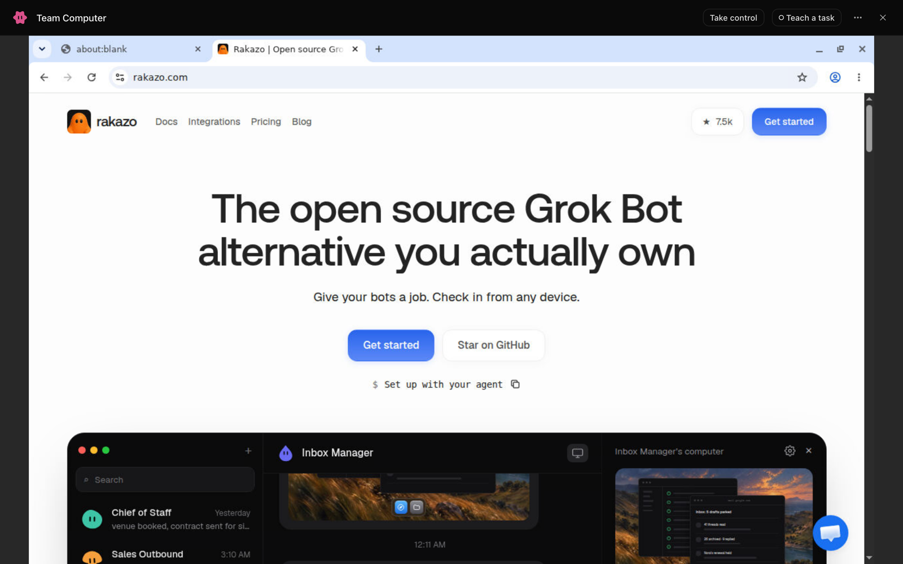
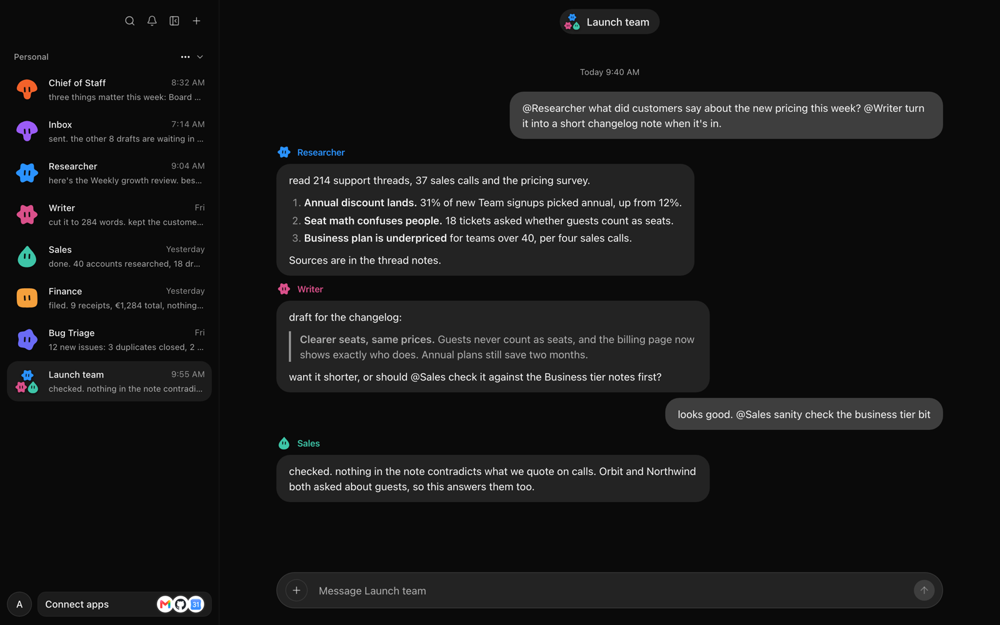
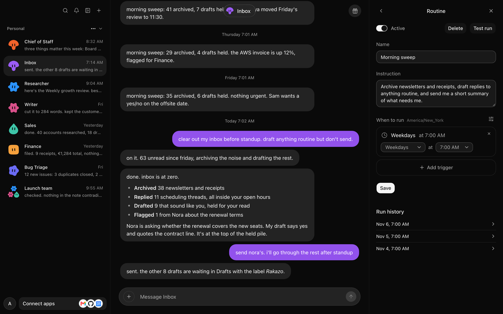
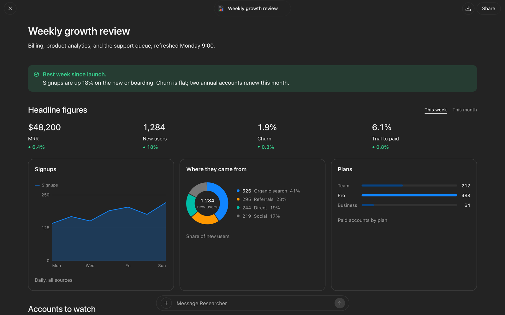
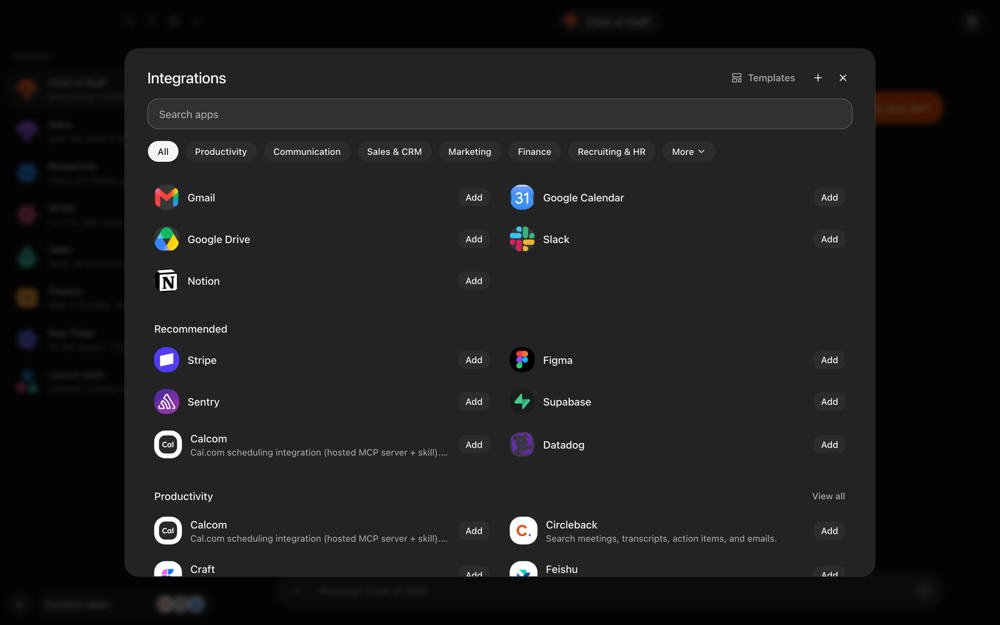
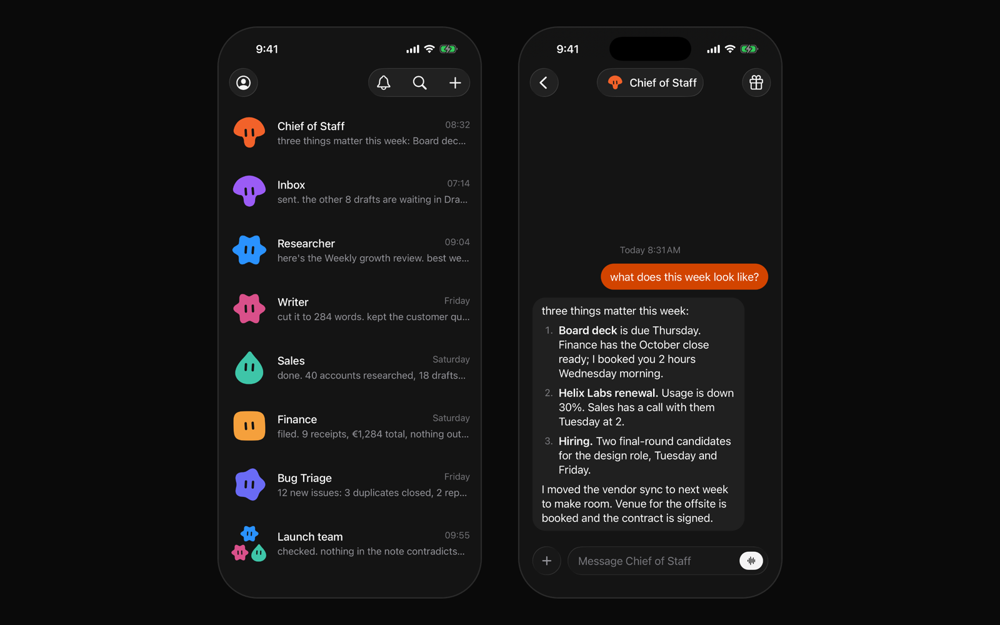

# Rakazo

[English](./README.md) | [简体中文](./README.zh-CN.md) | [日本語](./README.ja.md)

[](https://github.com/elie222/rakazo/stargazers)
[](https://discord.gg/RWwKa2Sn7h)
[](https://apps.apple.com/app/rakazo/id6801531099)
[](https://play.google.com/store/apps/details?id=com.rakazo.app)


Rakazo is an open source, self-hosted alternative to Grok Bot.

Persistent AI teammates with their own memory, routines, apps, and computer. Run it on your own
machine, with your own model.

Use it on the [web](https://app.rakazo.com), [desktop](https://rakazo.com/download/), [iPhone](https://apps.apple.com/app/rakazo/id6801531099), and
[Android](https://play.google.com/store/apps/details?id=com.rakazo.app).

It is also an alternative to Meta Muse, OpenAI Dots, Instinct, OpenClaw, Hermes Agent, and Claude
Duet.

Learn more at [rakazo.com](https://rakazo.com).

## Features

- Routines
- Memory
- Computer and browser use
- Private or shared team computers
- Sandboxes in Docker, the cloud, or on your own machine
- Group chats
- Delegation and subagents
- Builds dashboards and docs you can share by link
- Voice chat and calls
- Any model, with your own keys
- Thousands of app integrations, plus MCP

<table>
<tr>
<td width="50%" valign="top">

### Every bot gets a computer

A browser, terminal, files, and a full desktop. Watch it work, take control to sign in, and hand it back.



</td>
<td width="50%" valign="top">

### Bots that work together

Put bots in a group and @mention them. They split the work, check each other, and report back.



</td>
</tr>
<tr>
<td width="50%" valign="top">

### Routines

Run a bot on a schedule, from an email, or from a webhook, and see every run.



</td>
<td width="50%" valign="top">

### Pages

Bots build live dashboards and documents you can open full screen, share, and ask about.



</td>
</tr>
<tr>
<td width="50%" valign="top">

### Connected apps

Gmail, Slack, GitHub, Notion, Linear and thousands more, plus your own MCP servers and OpenAPI tools.



</td>
<td width="50%" valign="top">

### On every device

Web, desktop, iPhone, iPad, and Android, all talking to the same server.



</td>
</tr>
</table>

## Quick start (published images)

You need Docker Engine, the Compose plugin, curl, and OpenSSL. No clone or Node install.

```bash
mkdir -p rakazo && cd rakazo &&
curl -fsSLO https://raw.githubusercontent.com/elie222/rakazo/main/infra/compose/install-images.sh &&
bash install-images.sh
```

The installer downloads the Compose files, creates `.env` with random secrets, and starts Rakazo.
It preserves an existing `.env` when rerun.

Open [http://127.0.0.1:5173](http://127.0.0.1:5173), create an account, and connect a model.
Local Docker computers are on by default. Optional remote providers: `e2b`, `novita`, `daytona`, `createos`, `boat`, `boxd`, `instabox`, or `railway`
with the matching API key.

Default image tag is `edge` (main builds, `linux/amd64` + `linux/arm64`). Details and tags:
[self-hosting guide](./docs/self-host.md#published-images-no-checkout).

On restricted networks, override the installer download base (`RAKAZO_DOWNLOAD_BASE`), skip
existing Compose files (`--local` / `RAKAZO_DOWNLOAD_SKIP_EXISTING`), or mirror the bootstrap
script URL — see
[Restricted networks / mirror downloads](./docs/self-host.md#restricted-networks--mirror-downloads).

For an agent-assisted install, use [SETUP_PROMPT.md](./SETUP_PROMPT.md).

## Run on a server

Bots stay on when the backend runs on a server. Use the same installer on a VPS, then connect from
the desktop app, the mobile app, or a browser.

```bash
bash install-images.sh --prepare-only
# edit .env: SANDBOX_PROVIDER=boat (or e2b / daytona / createos) with its API key, RAKAZO_HOST=your.domain
bash install-images.sh
```

Put HTTPS in front of port 5173; [docs/self-host-production.md](./docs/self-host-production.md#public-single-vm-deployment)
covers the Caddy setup and host hardening. In the desktop app choose **Existing instance** and enter
the `https://` address.

Or [deploy on Railway](https://railway.com/new/template/rakazo-template); see the [Railway setup guide](./infra/railway/README.md).

## Local development (source checkout)

You need Node.js 24.15.0 or newer in the 24.x line, or Node.js 26+; pnpm 12;
and Docker. Node.js 25.x is not supported.

```bash
git clone https://github.com/elie222/rakazo.git
cd rakazo
cp .env.example .env
```

Set `POSTGRES_PASSWORD` and `POSTGRES_APP_PASSWORD` to two values from `openssl rand -hex 16`,
then put them in `DATABASE_MIGRATION_URL` and `DATABASE_URL`. The app connects as its own
`rakazo_app` login, which row-level security applies to; migrations run as the owner
([database roles](docs/self-host-configuration.md#database-roles)). Set `BETTER_AUTH_SECRET`, `ENCRYPTION_KEY`, and `SCREEN_PROXY_SECRET` to
independent long random values. Docker sandboxes also need a dedicated
`SANDBOX_SUPERVISOR_TOKEN`. You can also set `OPENROUTER_API_KEY`, or connect a supported
model provider during onboarding.

For host-side development with Docker Desktop, set `SANDBOX_CONTROL_VIA_LOOPBACK=true`
in `.env`. The supervisor discovers Docker Desktop's user socket automatically;
`DOCKER_HOST` or `DOCKER_SOCKET` can override it for another Docker runtime.

Managed app catalogs are optional. Set `COMPOSIO_API_KEY` for Composio, or the
`PIPEDREAM_CLIENT_ID`, `PIPEDREAM_CLIENT_SECRET`, and `PIPEDREAM_PROJECT_ID` trio for Pipedream
Connect. Users can add an HTTPS MCP server or OpenAPI JSON document from **Integrations** without
enabling either managed catalog. Connector credentials are encrypted on the server and are never
returned by the API.

Paid data services (map places, search results, work emails, profiles, SEO data) are optional too.
Set `PAID_SERVICES_PROVIDER=treg` and `PAID_SERVICES_API_KEY` to an org-scoped
[Treg](https://treg.to) token, and bots can find and call them on the deployment's account. When
model credits are on, each call is charged to the organization's credits at the provider's cost
plus 20%.

```bash
pnpm install
pnpm sandbox:build
pnpm dev
```

`pnpm dev` uses the Postgres in `DATABASE_URL` when it accepts a connection. Otherwise it starts a
local `rakazo-dev-postgres` container with Docker, and every checkout reuses that one. It applies
migrations and generates the Prisma client before starting. A branch that adds migrations main
doesn't have gets its own database on the same server, copied from the shared one when possible,
so unmerged schema changes stay out of it. When the default ports are taken, for example by
another git worktree, it moves to the next free block and prints the URL. Set `WEB_PORT` and
`API_PORT` to choose ports yourself.

To try a checkout from your phone or another computer, install [Tailscale](https://tailscale.com)
on each device and set `RAKAZO_DEV_TAILNET=1` in `.env`. `pnpm dev` then serves the web app over
HTTPS at `https://<machine>.<tailnet>.ts.net:<web port>`, reachable only from devices on your
tailnet, and stops serving it when you quit. Sign in at that URL on every device, including the
one running it. The first run may ask you to turn on HTTPS certificates for your tailnet.

To keep keys in a secrets manager instead of `.env`, set `RAKAZO_DEV_RUN_WITH` to the command
that runs another with your secrets added, for example `op run --env-file=dev.env --` or
`infisical run --env=dev --projectId=<project> --`. `pnpm dev` then starts inside it, and the
values it adds win over `.env`.

To run Postgres from the Compose file instead, start it with the `postgres-host` overlay, which
publishes loopback `127.0.0.1:5433`, and point `DATABASE_URL` and `DATABASE_MIGRATION_URL` at it:

```bash
docker compose --env-file .env \
  -f infra/compose/docker-compose.yml \
  -f infra/compose/docker-compose.postgres-host.yml \
  up postgres -d
```

Use a URI-safe `POSTGRES_PASSWORD` (`openssl rand -hex 16`). An existing `pgdata` volume keeps the
user, password, and database from first init, so keep those values in `.env`, or change them in
place with `ALTER ROLE` / rename. Recreate the volume only after a backup (or when the data is
disposable); `docker compose down -v` deletes all Postgres state.

Open the printed URL ([http://127.0.0.1:5173](http://127.0.0.1:5173) by default), create an account, connect a model, and create
your first bot.

For deployment, provider selection, backups, and upgrades, see the
[self-hosting guide](./docs/self-host.md), [production deployment](./docs/self-host-production.md),
[backup and restore](./docs/self-host-backups.md), and [upgrading](./docs/self-host-upgrading.md).

To use CreateOS, set `SANDBOX_PROVIDER=createos` and `CREATEOS_SANDBOX_API_KEY`.
Optional `CREATEOS_SANDBOX_BASE_URL`, `CREATEOS_SANDBOX_SHAPE`, and
`CREATEOS_SANDBOX_ROOTFS` default to `https://api.sb.createos.sh`, `s-2vcpu-2gb`,
and `desktop:1`.

To use Railway computers, set `SANDBOX_PROVIDER=railway`, `RAILWAY_API_TOKEN`
and `RAILWAY_ENVIRONMENT_ID` on the API and worker. Choose the sandbox environment
explicitly; Railway's automatic environment ID identifies the hosted app's environment.
Use the narrowest Railway API token that works: prefer a project token if sufficient
for sandbox operations and supported by the client's authentication. This provider
currently uses bearer authentication, so use a team/workspace token rather than a
personal account token.
The live screen and desktop require `PRIVATE` networking so Railway's public domain
can serve the screen. Computers use this mode and can reach other services in the
same Railway project/environment, as well as the public internet. We recommend a
dedicated Railway project (or at least a separate environment) for sandboxes,
separate from the app and database. Recreate existing `ISOLATED` computers before use.
The desktop is installed on first start. Stopping a computer saves its portable
home and destroys the sandbox; the next start restores that home in a new sandbox.
Railway sandbox usage is metered.
New computers start in Railway's default region. Set `RAILWAY_SANDBOX_REGION` (for example
`asia-southeast1-eqsg3a`) to keep them near the API; a running computer moves on its next start.
Workspace exports reject files above 64 MiB without truncating them. Set `RAILWAY_MAX_WORKSPACE_FILE_BYTES` to change this limit.

## Desktop and mobile

The Electron and Expo apps are clients of the same Rakazo API used by the web app.

With the development stack running, launch Electron with:

```bash
pnpm --filter @rakazo/desktop dev
```

On first run the desktop app asks whether to run Rakazo on this computer or connect to an existing
server. **This computer** can run without Docker on Apple silicon Macs with macOS 26 or later
when the build includes a server bundle. Fresh setups use this path: the app downloads the server
and computer runtime as needed. Existing Docker setups are offered a move while Docker is running;
choosing **Keep Docker** leaves them on Docker.

Other builds and platforms use Docker Compose to install and start the published images (the same
files as `infra/compose/install-images.sh`) under the app's data directory. This path needs Docker
Desktop, OrbStack, or Docker Engine. Without one, setup offers the Docker Desktop download, opens
an installed Docker app that is not running, and continues on its own once Docker answers. Installed
builds pin the image tag to their own version; unpackaged builds pull `edge`. Developers running
`pnpm dev` should pick **Existing instance** with `http://127.0.0.1:5173` instead. Public servers
must use HTTPS; HTTP is accepted only for loopback and private LAN addresses (not link-local). The
app verifies Rakazo's health endpoint before saving, and later launches go straight to that
instance. The Docker stack keeps running after the app quits; the Docker-free server stops with the app.
**Stop Local Stack** in the application menu stops the managed stack without quitting.

On Linux the desktop app ships as an AppImage, which needs FUSE 2 (`libfuse.so.2`). Distributions
that only include FUSE 3, such as Fedora Silverblue or Ubuntu 24.04, show
`dlopen(): error loading libfuse.so.2`. Install the FUSE 2 library (`fuse-libs` on Fedora,
`libfuse2t64` on Ubuntu 24.04, `libfuse2` on older Ubuntu and Debian), or run the AppImage without
FUSE:

```bash
chmod +x Rakazo-*.AppImage
./Rakazo-*.AppImage --appimage-extract-and-run
```

The Docker path of **This computer** looks for the `docker` CLI and does not detect Podman. To try another
Docker-compatible CLI that supports the `compose` commands, set `RAKAZO_DOCKER_BINARY` to its path
before starting the app.

Use **Change Rakazo Server…** in the application menu to reconnect. Closing that window without
saving returns to the previous instance. For development automation, set `RAKAZO_WEB_URL` to point
the shell somewhere else without changing the saved instance, or `RAKAZO_FORCE_SETUP=1` to run
setup again.

Mobile build and release instructions live in [docs/mobile-release.md](./docs/mobile-release.md).

## UI language

The web (and Electron-hosted) UI supports English, Deutsch, 한국어, Türkçe, हिन्दी,
Português (Brasil), 简体中文, 繁體中文, Español, Русский, Français, עברית, Nederlands, 日本語, and Polski under
**Settings → Language**. The Expo app ships the same 15 languages under
**Account → Language**. A device language or
`EXPO_PUBLIC_DEFAULT_UI_LOCALE` still selects the starting catalog before a saved choice.
Native Electron setup and menus also support the web UI's languages, following the saved app
choice or, on first launch, the system language. The marketing homepage (`apps/www`) offers all
15 languages through footer links, including `/zh/` and `/zh-tw/`; other marketing pages remain
primarily English.

## Development

```text
apps/       web, api, worker, desktop, mobile, and public website
packages/   domain, contracts, persistence, adapters, UI, and test tooling
infra/      local services and computer images
docs/       architecture, operations, and release guides
```

Common checks:

```bash
pnpm lint
pnpm check
pnpm test
pnpm test:integration
pnpm test:e2e
```

See [CONTRIBUTING.md](./CONTRIBUTING.md) for the development workflow and test matrix.

## Documentation

Chinese guides cover [self-hosting](./docs/zh-CN/self-host.md), [models](./docs/zh-CN/self-host-models.md),
[backups](./docs/zh-CN/self-host-backups.md), [upgrading](./docs/zh-CN/self-host-upgrading.md), and
[restricted networks](./docs/zh-CN/self-host-restricted-network.md).

- [Self-hosting](./docs/self-host.md)
- [Self-host configuration](./docs/self-host-configuration.md)
- [Self-host secrets](./docs/self-host-secrets.md)
- [Sign-in and accounts](./docs/self-host-accounts.md)
- [Models](./docs/self-host-models.md)
- [Tools and integrations](./docs/self-host-integrations.md)
- [Computer providers](./docs/self-host-sandbox-providers.md)
- [Docker computers](./docs/self-host-docker-computers.md)
- [Storage and encryption](./docs/self-host-storage.md)
- [Production deployment](./docs/self-host-production.md)
- [Backup and restore](./docs/self-host-backups.md)
- [Upgrading](./docs/self-host-upgrading.md)
- [Logs and monitoring](./docs/self-host-observability.md)
- [Audit log](./docs/self-host-audit-log.md)
- [Apps and clients](./docs/self-host-clients.md)
- [Billing](./docs/self-host-billing.md)
- [Computer runtime and isolation](./docs/computer-runtime.md)
- [Desktop releases](./docs/desktop-release.md)
- [Mobile releases](./docs/mobile-release.md)
- [Performance testing](./docs/performance.md)
- [Bots that manage bots](./docs/fleet-management.md)

## How Rakazo compares

- [Grok Bot](https://rakazo.com/grok-bot-alternative/)
- [Muse](https://rakazo.com/muse-alternative/)
- [Dots](https://rakazo.com/dots-alternative/)
- [Instinct](https://rakazo.com/instinct-alternative/)
- [OpenClaw](https://rakazo.com/openclaw-alternative/)
- [Hermes Agent](https://rakazo.com/hermes-alternative/)
- [All comparisons](https://rakazo.com/alternatives/)

## Thanks

- [Inbox Zero](https://getinboxzero.com/?utm_source=github&utm_medium=referral&utm_campaign=rakazo_readme)
- [PromptLayer](https://promptlayer.com/?utm_source=github&utm_medium=referral&utm_campaign=rakazo_readme)
- [ConnectorMap](https://connectormap.luinbytes.dev/?utm_source=github&utm_medium=referral&utm_campaign=rakazo_readme)
- [CodeRabbit](https://www.coderabbit.ai/?utm_source=github&utm_medium=referral&utm_campaign=rakazo_readme)
- [Greptile](https://www.greptile.com/?utm_source=github&utm_medium=referral&utm_campaign=rakazo_readme)
- [Snyk](https://snyk.io/?utm_source=github&utm_medium=referral&utm_campaign=rakazo_readme)
- [Incredibuild](https://www.incredibuild.com/?utm_source=github&utm_medium=referral&utm_campaign=rakazo_readme)

## Stack

- TypeScript
- React 19, Vite, and Tailwind CSS
- Electron and Expo
- Hono and oRPC
- PostgreSQL and Prisma
- Better Auth
- Graphile Worker
- Pi
- Docker, E2B, Daytona, CreateOS, and Boat
- Composio, Pipedream Connect, MCP, and OpenAPI integrations

## Contributing

Contributions are welcome. Please read [CONTRIBUTING.md](./CONTRIBUTING.md) before opening a pull
request. For security vulnerabilities, follow [SECURITY.md](./SECURITY.md) instead of filing a public
issue.

Rakazo is licensed under the [Apache License 2.0](./LICENSE).

Questions and ideas are welcome in the [Rakazo Discord community](https://discord.gg/RWwKa2Sn7h).
