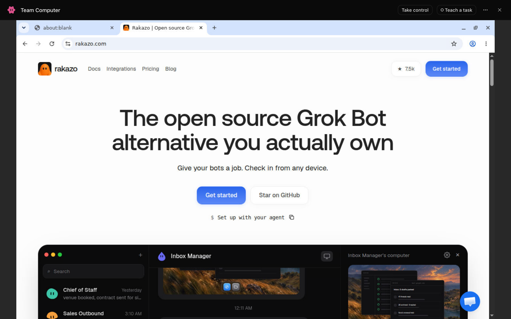
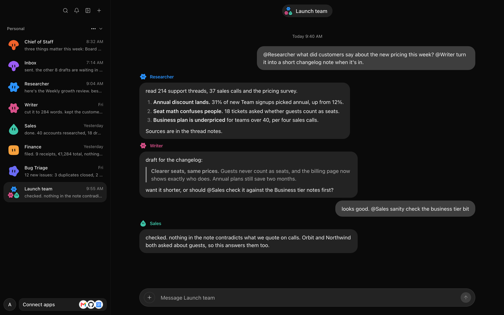
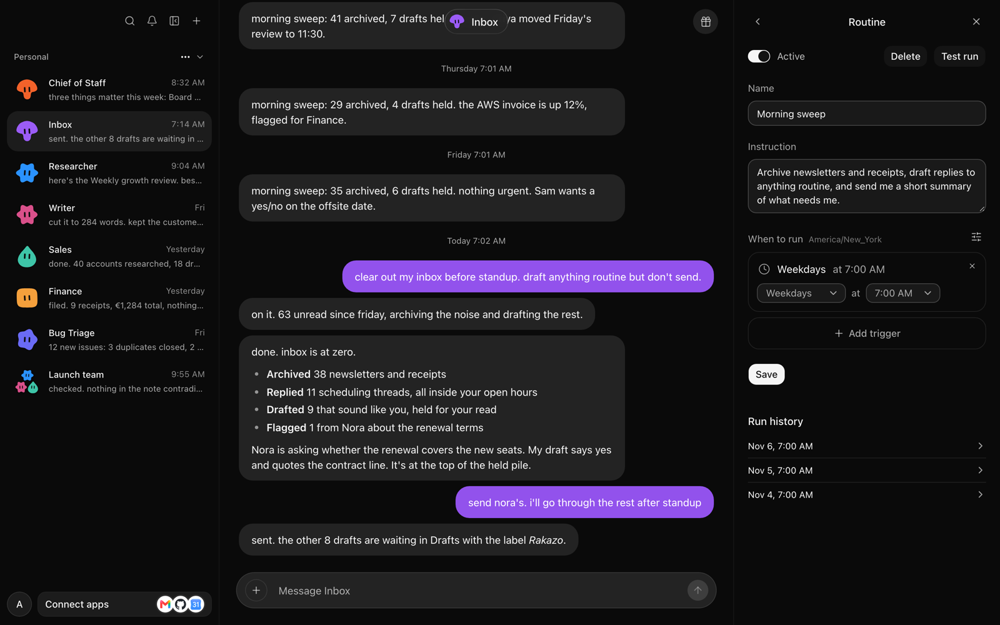
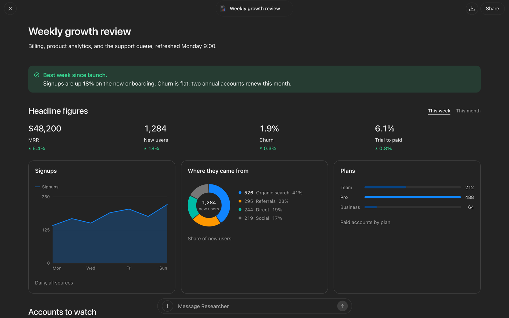
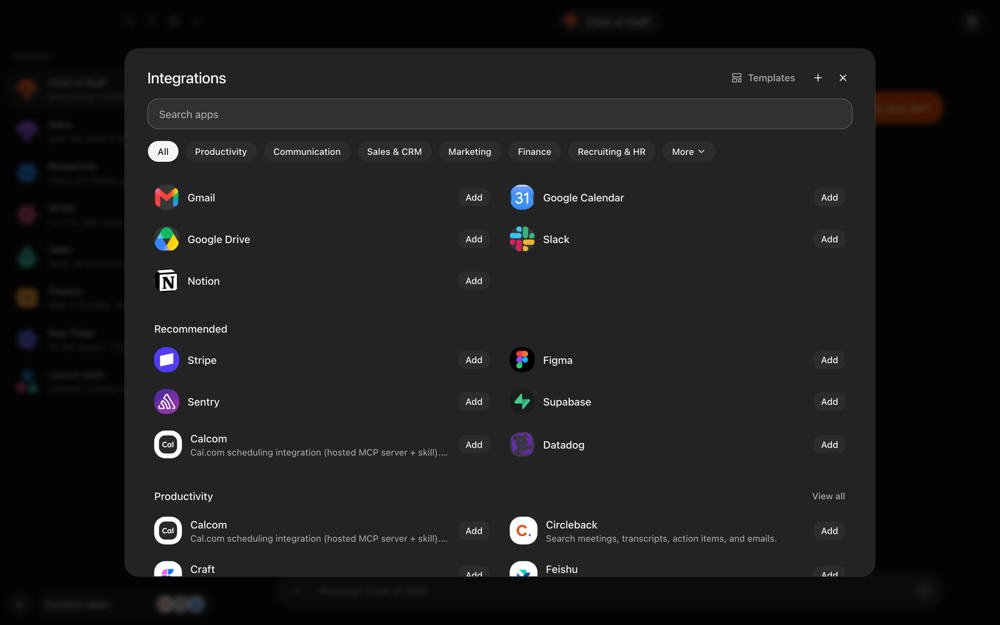
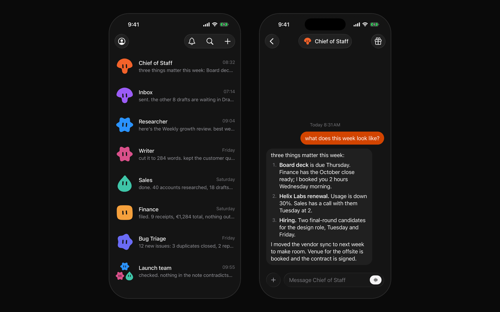

# Rakazo

[English](./README.md) | [简体中文](./README.zh-CN.md) | [日本語](./README.ja.md)

[](https://github.com/elie222/rakazo/stargazers)
[](https://discord.gg/RWwKa2Sn7h)
[](https://apps.apple.com/app/rakazo/id6801531099)
[](https://play.google.com/store/apps/details?id=com.rakazo.app)


Rakazo 是 Grok Bot 的开源、自托管替代方案。

长期在线的 AI 队友，各自拥有记忆、例行任务、应用和计算机。在自己的机器上运行，使用自己的模型。

可在[网页](https://app.rakazo.com)、[桌面端](https://rakazo.com/download/)、[iPhone](https://apps.apple.com/app/rakazo/id6801531099) 和
[Android](https://play.google.com/store/apps/details?id=com.rakazo.app) 上使用。

它也是 Meta Muse、OpenAI Dots、Instinct、OpenClaw、Hermes Agent 和 Claude Duet 的替代方案。

详情见 [rakazo.com](https://rakazo.com)。

本文是 [英文 README](./README.md) 的简体中文译文。[自托管指南](./docs/zh-CN/self-host.md)已提供中文。

## 功能

- 例行任务
- 记忆
- 使用计算机和浏览器
- 私有或共享的团队计算机
- 在 Docker、云端或自己的机器上运行沙箱
- 群聊
- 任务委派与子智能体
- 构建可通过链接分享的仪表盘和文档
- 语音聊天和通话
- 任意模型，使用自己的密钥
- 数千个应用集成，并支持 MCP

<table>
<tr>
<td width="50%" valign="top">

### 每个机器人都有一台计算机

浏览器、终端、文件和完整桌面。看着它工作，需要登录时接管，再交还给它。



</td>
<td width="50%" valign="top">

### 协同工作的机器人

把机器人拉进群聊并 @ 它们。它们分工合作、互相检查，再向你汇报。



</td>
</tr>
<tr>
<td width="50%" valign="top">

### 例行任务

按计划、收到邮件或 Webhook 时运行机器人，并查看每一次运行。



</td>
<td width="50%" valign="top">

### 页面

机器人构建实时仪表盘和文档，可全屏打开、分享，并就其提问。



</td>
</tr>
<tr>
<td width="50%" valign="top">

### 连接应用

Gmail、Slack、GitHub、Notion、Linear 等数千个应用，以及你自己的 MCP 服务器和 OpenAPI 工具。



</td>
<td width="50%" valign="top">

### 全平台可用

网页、桌面端、iPhone、iPad 和 Android，连接同一台服务器。



</td>
</tr>
</table>

## 快速开始（已发布镜像）

需要 Docker Engine、Compose 插件、curl 和 OpenSSL。无需克隆仓库或安装 Node.js。

```bash
mkdir -p rakazo && cd rakazo &&
curl -fsSLO https://raw.githubusercontent.com/elie222/rakazo/main/infra/compose/install-images.sh &&
bash install-images.sh
```

安装脚本会下载 Compose 文件，生成包含随机密钥的 `.env`，并启动 Rakazo。
再次运行时会保留已有的 `.env`。

打开 [http://127.0.0.1:5173](http://127.0.0.1:5173)，创建账号并连接模型。
默认启用本地 Docker 计算机。远程计算机所需的凭据、模板和准备步骤见[计算机提供商（英文）](./docs/self-host-sandbox-providers.md)。

默认镜像标签为 `edge`，由主分支构建，支持 `linux/amd64` 和 `linux/arm64`。
镜像详情与标签见[自托管指南](./docs/zh-CN/self-host.md#已发布镜像无需检出源码)。

在受限网络中，可以覆盖安装器的下载地址前缀（`RAKAZO_DOWNLOAD_BASE`），跳过已有的 Compose 文件
（`--local` / `RAKAZO_DOWNLOAD_SKIP_EXISTING`），或使用引导脚本的镜像地址。
参见[受限网络与镜像下载](./docs/zh-CN/self-host-restricted-network.md)。

如需让智能体协助安装，请使用 [SETUP_PROMPT.md](./SETUP_PROMPT.md)。

## 在服务器上运行

后端在服务器上运行时，机器人可以持续在线。在 VPS 上使用同一个安装脚本，
然后通过桌面应用、移动应用或浏览器连接。

```bash
bash install-images.sh --prepare-only
# edit .env: SANDBOX_PROVIDER=boat (or e2b / daytona / createos) with its API key, RAKAZO_HOST=your.domain
bash install-images.sh
```

为 5173 端口配置 HTTPS 入口。[docs/self-host-production.md](./docs/self-host-production.md#public-single-vm-deployment)
介绍了 Caddy 配置和主机加固方法。在桌面应用中选择 **Existing instance**（现有实例），填写 `https://` 地址。

也可以[部署到 Railway](https://railway.com/new/template/rakazo-template)；参见
[Railway 设置指南](./infra/railway/README.md)。

## 本地开发（从源码运行）

需要 Node.js 24.x（至少 24.15.0）或 Node.js 26 及以上版本，以及 pnpm 12 和 Docker。
不支持 Node.js 25.x。

```bash
git clone https://github.com/elie222/rakazo.git
cd rakazo
cp .env.example .env
```

将 `POSTGRES_PASSWORD` 和 `POSTGRES_APP_PASSWORD` 分别设置为由 `openssl rand -hex 16` 生成的两个值，再把它们填入 `DATABASE_MIGRATION_URL` 和 `DATABASE_URL`。
应用以自己的 `rakazo_app` 登录身份连接数据库，并受行级安全策略约束；迁移则以所有者身份运行（参见 [数据库角色](docs/self-host-configuration.md#database-roles)）。
为 `BETTER_AUTH_SECRET`、`ENCRYPTION_KEY` 和 `SCREEN_PROXY_SECRET` 分别设置独立的长随机值。
Docker 沙箱还需要专用的 `SANDBOX_SUPERVISOR_TOKEN`。
你也可以设置 `OPENROUTER_API_KEY`，或在首次设置时连接支持的模型提供商。

使用 Docker Desktop 在宿主机上开发时，在 `.env` 中设置 `SANDBOX_CONTROL_VIA_LOOPBACK=true`。
沙箱监督服务会自动发现 Docker Desktop 的用户套接字；使用其他 Docker 运行环境时，
可以通过 `DOCKER_HOST` 或 `DOCKER_SOCKET` 覆盖该设置。

托管应用目录是可选功能。使用 Composio 时设置 `COMPOSIO_API_KEY`；
使用 Pipedream Connect 时设置 `PIPEDREAM_CLIENT_ID`、`PIPEDREAM_CLIENT_SECRET` 和 `PIPEDREAM_PROJECT_ID`。
即使不启用这两个托管目录，用户也可以在 **Integrations**（集成）中添加 HTTPS MCP 服务器或
OpenAPI JSON 文档。连接器凭据在服务器上加密存储，API 不会返回这些凭据。

付费数据服务（地图地点、搜索结果、工作邮箱、个人资料、SEO 数据）同样是可选的。
设置 `PAID_SERVICES_PROVIDER=treg`，并在 `PAID_SERVICES_API_KEY` 中填入组织级 [Treg](https://treg.to) 令牌，
机器人即可使用部署方的账户查找并调用这些服务。启用模型额度时，每次调用按提供商成本加 20%
从组织的额度中扣除。

```bash
pnpm install
pnpm sandbox:build
pnpm dev
```

`pnpm dev` 会使用 `DATABASE_URL` 指向且可连接的 Postgres；否则会通过 Docker 启动本地
`rakazo-dev-postgres` 容器，所有检出目录共用该容器。启动服务前会应用数据库迁移并生成 Prisma 客户端。
如果当前分支新增了 `main` 尚未包含的迁移，会在同一服务器上使用独立数据库，条件允许时从共享数据库复制，
避免未合入的数据库结构变更影响共享数据库。默认端口被占用时（例如另一个 Git worktree 正在运行），
会选择下一个空闲端口组并打印访问地址。也可以设置 `WEB_PORT` 和 `API_PORT` 自行指定端口。

要从手机或另一台电脑访问当前检出目录，请在每台设备上安装 [Tailscale](https://tailscale.com)，
并在 `.env` 中设置 `RAKAZO_DEV_TAILNET=1`。`pnpm dev` 随后会通过 HTTPS 提供网页，地址为
`https://<machine>.<tailnet>.ts.net:<web port>`，只有 tailnet 中的设备可以访问；退出 `pnpm dev` 后停止提供。
每台设备都用这个地址登录，包括运行服务的那台。首次运行时，Tailscale 可能要求你为 tailnet 开启 HTTPS 证书。

如果要把密钥放在 secrets manager 而不是 `.env` 中，可将 `RAKAZO_DEV_RUN_WITH` 设为先注入密钥再运行命令的
命令，例如 `op run --env-file=dev.env --` 或 `infisical run --env=dev --projectId=<project> --`。
`pnpm dev` 会在其中启动，注入的值优先于 `.env`。

如需改用 Compose 中的 Postgres，可通过 `postgres-host` 叠加配置启动，将端口发布到回环地址
`127.0.0.1:5433`，并让 `DATABASE_URL` 和 `DATABASE_MIGRATION_URL` 指向它：

```bash
docker compose --env-file .env \
  -f infra/compose/docker-compose.yml \
  -f infra/compose/docker-compose.postgres-host.yml \
  up postgres -d
```

`POSTGRES_PASSWORD` 应使用无需 URI 转义的字符，例如通过 `openssl rand -hex 16` 生成。
已有的 `pgdata` 数据卷会保留首次初始化时的用户、密码和数据库，
因此应保留 `.env` 中相应的值，或使用 `ALTER ROLE`、重命名等方式在数据库中修改。
只有在完成备份后，或确认数据可以丢弃时，才重建数据卷；`docker compose down -v` 会删除全部 Postgres 数据。

打开终端打印的地址（默认是 [http://127.0.0.1:5173](http://127.0.0.1:5173)），创建账号、连接模型，并创建第一个机器人。

部署、提供商选择、备份与升级说明见[自托管指南](./docs/zh-CN/self-host.md)。

使用 CreateOS 时，设置 `SANDBOX_PROVIDER=createos` 和 `CREATEOS_SANDBOX_API_KEY`。
可选配置 `CREATEOS_SANDBOX_BASE_URL`、`CREATEOS_SANDBOX_SHAPE` 和 `CREATEOS_SANDBOX_ROOTFS`
的默认值分别为 `https://api.sb.createos.sh`、`s-2vcpu-2gb` 和 `desktop:1`。

使用 Railway 计算机时，在 API 和 worker 上设置 `SANDBOX_PROVIDER=railway`、`RAILWAY_API_TOKEN`
和 `RAILWAY_ENVIRONMENT_ID`。请显式选择沙箱环境；Railway 自动注入的环境 ID 对应的是托管应用所在的环境。
使用能完成所需操作的最小权限 Railway API 令牌：若项目令牌满足沙箱操作要求且客户端认证支持，则优先使用项目令牌。
当前提供商使用 Bearer 认证，因此应使用团队或工作区令牌，而非个人账号令牌。

实时屏幕和桌面需要 `PRIVATE` 网络模式，才能通过 Railway 公共域名提供屏幕访问。
计算机采用此模式，可以访问同一 Railway 项目和环境中的其他服务，也可以访问公网。
建议为沙箱使用专用 Railway 项目，或至少使用独立环境，与应用和数据库分开。
已有的 `ISOLATED` 计算机需要重建后再使用。

桌面环境会在首次启动时安装。停止计算机会保存可迁移的主目录并销毁沙箱；下次启动时，在新沙箱中恢复该主目录。
Railway 沙箱按用量计费。
新建计算机使用 Railway 的默认区域。可设置 `RAILWAY_SANDBOX_REGION`（例如 `asia-southeast1-eqsg3a`），
使其更靠近 API；已运行的计算机会在下次启动时迁移。
工作区导出会拒绝超过 64 MiB 的文件，不会截断文件内容。可通过 `RAILWAY_MAX_WORKSPACE_FILE_BYTES` 修改此限制。

## 桌面端与移动端

Electron 和 Expo 应用都是 Rakazo API 的客户端，与网页版使用同一套 API。

开发服务启动后，使用以下命令启动 Electron：

```bash
pnpm --filter @rakazo/desktop dev
```

首次运行时，桌面应用会询问是在这台电脑上运行 Rakazo，还是连接现有服务器。
选择 **This computer**（这台电脑）时，搭载 Apple 芯片、运行 macOS 26 或更高版本且构建包含服务器包的 Mac
可以不使用 Docker。全新设置默认采用此方式，由应用按需下载服务器和计算机运行时。
已有 Docker 服务栈且 Docker 正在运行时，应用会询问是否迁移；选择 **Keep Docker** 会继续使用 Docker。

其他构建和平台通过 Docker Compose 在应用数据目录中安装并启动已发布镜像，
使用的文件与 `infra/compose/install-images.sh` 相同。这一路径需要 Docker Desktop、OrbStack 或 Docker Engine；
未安装时，应用会提供下载链接。已安装的发行版将镜像标签固定为自身版本，未打包的开发版本则拉取 `edge`。

运行 `pnpm dev` 的开发者应选择 **Existing instance**（现有实例），地址填写终端打印的地址（默认为 `http://127.0.0.1:5173`）。
公共服务器必须使用 HTTPS；只有回环地址和局域网私有地址允许 HTTP，不包括链路本地地址。
应用会在保存地址前检查 Rakazo 的健康检查端点，之后启动时直接连接该实例。
退出应用后，Docker 服务栈仍会继续运行；不使用 Docker 的服务器则随应用停止。
可通过应用菜单中的 **Stop Local Stack**（停止本地服务栈）停止受管服务栈，而无需退出应用。

在 Linux 上，桌面应用以 AppImage 形式发布，需要 FUSE 2（`libfuse.so.2`）。只包含 FUSE 3 的发行版（例如 Fedora Silverblue 或 Ubuntu 24.04）会报错
`dlopen(): error loading libfuse.so.2`。请安装 FUSE 2 库（Fedora 上为 `fuse-libs`，Ubuntu 24.04 上为 `libfuse2t64`，较早的 Ubuntu 和 Debian 上为 `libfuse2`），或者不借助 FUSE 运行 AppImage：

```bash
chmod +x Rakazo-*.AppImage
./Rakazo-*.AppImage --appimage-extract-and-run
```

**This computer** 的 Docker 路径会查找 `docker` CLI，但不会自动识别 Podman。若要尝试另一个支持 `compose` 命令的
Docker 兼容 CLI，请在启动应用前把 `RAKAZO_DOCKER_BINARY` 设为该 CLI 的路径。

使用应用菜单中的 **Change Rakazo Server…**（更换 Rakazo 服务器）重新选择服务器。
关闭该窗口且不保存时，会返回之前的实例。
开发自动化中，可以设置 `RAKAZO_WEB_URL`，让桌面应用连接其他地址而不改变已保存的实例；
也可以设置 `RAKAZO_FORCE_SETUP=1`，再次运行设置流程。

移动端构建和发布说明见 [docs/mobile-release.md](./docs/mobile-release.md)。

## 界面语言

网页版及 Electron 内嵌界面可在 **Settings → Language**（设置 → 语言）中选择英语、德语、韩语、土耳其语、
印地语、巴西葡萄牙语、简体中文、繁体中文、西班牙语、俄语、法语、希伯来语、荷兰语、日语和波兰语。
Expo 应用包含英语、简体中文、繁体中文、俄语、德语、荷兰语、日语、西班牙语和波兰语翻译，**Account → Language**（账户 → 语言）列出这九种语言。
在用户保存选择之前，移动端的初始语言由设备语言或 `EXPO_PUBLIC_DEFAULT_UI_LOCALE` 决定。

Electron 原生设置窗口和菜单也支持上述网页版语言，并跟随应用中保存的选择；首次启动使用系统语言。

官网首页（`apps/www`）可通过页脚切换全部 15 种语言，简体中文路径为 `/zh/`，繁体中文为 `/zh-tw/`。
其他官网页面主要仍为英文。

## 开发

```text
apps/       网页端、API、worker、桌面端、移动端和官网
packages/   领域逻辑、契约、持久化、适配器、UI 和测试工具
infra/      本地服务和计算机镜像
docs/       架构、运维和发布指南
```

常用检查命令：

```bash
pnpm lint
pnpm check
pnpm test
pnpm test:integration
pnpm test:e2e
```

开发流程和测试矩阵见 [CONTRIBUTING.md](./CONTRIBUTING.md)。

## 文档

- [自托管](./docs/zh-CN/self-host.md)
- [模型接入、审批与语音](./docs/zh-CN/self-host-models.md)
- [备份与恢复](./docs/zh-CN/self-host-backups.md)
- [升级](./docs/zh-CN/self-host-upgrading.md)
- [受限网络与镜像下载](./docs/zh-CN/self-host-restricted-network.md)
- [无影云电脑](./docs/wuying-computers.zh-CN.md)
- [部署配置](./docs/self-host-configuration.md)、[密钥管理](./docs/self-host-secrets.md)、[账号与登录](./docs/self-host-accounts.md)（英文）
- [工具集成](./docs/self-host-integrations.md)、[计算机提供商](./docs/self-host-sandbox-providers.md)、[Docker 计算机](./docs/self-host-docker-computers.md)（英文）
- [存储与加密](./docs/self-host-storage.md)、[生产部署](./docs/self-host-production.md)、[日志与监控](./docs/self-host-observability.md)、[审计日志](./docs/self-host-audit-log.md)（英文）
- [客户端](./docs/self-host-clients.md)、[计费](./docs/self-host-billing.md)、[计算机运行时与隔离](./docs/computer-runtime.md)（英文）
- [桌面端发布](./docs/desktop-release.md)、[移动端发布](./docs/mobile-release.md)、[性能测试](./docs/performance.md)、[管理机器人的机器人](./docs/fleet-management.md)（英文）

## 与其他产品的比较

Rakazo 启动后，你可以像使用 Grok Bot 一样，通过聊天设置和管理机器人。
Muse、Dots、Instinct 和 Claude Duet 是托管式助手；OpenClaw 和 Hermes Agent 则同样是可以自行运行的开源智能体。
后两者的文档介绍了安装器、配置文件和网关。Hermes Desktop 无需命令行即可开始第一次聊天；消息网关则是独立进程。

- [Grok Bot](https://rakazo.com/grok-bot-alternative/)
- [Muse](https://rakazo.com/muse-alternative/)
- [Dots](https://rakazo.com/dots-alternative/)
- [Instinct](https://rakazo.com/instinct-alternative/)，可通过短信或电话交流的个人助手
- [OpenClaw](https://rakazo.com/openclaw-alternative/)
- [Hermes Agent](https://rakazo.com/hermes-alternative/)，Nous Research 的开源智能体
- [Claude Duet](https://rakazo.com/claude-duet-alternative/)，Anthropic 的主动式个人智能体
- [全部对比](https://rakazo.com/alternatives/)
- [自托管指南](https://rakazo.com/self-hosted-ai-agent/)

## 致谢

- [Inbox Zero](https://getinboxzero.com/?utm_source=github&utm_medium=referral&utm_campaign=rakazo_readme)
- [PromptLayer](https://promptlayer.com/?utm_source=github&utm_medium=referral&utm_campaign=rakazo_readme)
- [ConnectorMap](https://connectormap.luinbytes.dev/?utm_source=github&utm_medium=referral&utm_campaign=rakazo_readme)
- [CodeRabbit](https://www.coderabbit.ai/?utm_source=github&utm_medium=referral&utm_campaign=rakazo_readme)
- [Greptile](https://www.greptile.com/?utm_source=github&utm_medium=referral&utm_campaign=rakazo_readme)
- [Snyk](https://snyk.io/?utm_source=github&utm_medium=referral&utm_campaign=rakazo_readme)
- [Incredibuild](https://www.incredibuild.com/?utm_source=github&utm_medium=referral&utm_campaign=rakazo_readme)

## 技术栈

- TypeScript
- React 19、Vite 和 Tailwind CSS
- Electron 和 Expo
- Hono 和 oRPC
- PostgreSQL 和 Prisma
- Better Auth
- Graphile Worker
- Pi
- Docker、E2B、Daytona、CreateOS 和 Boat
- Composio、Pipedream Connect、MCP 和 OpenAPI 集成

## 参与贡献

欢迎贡献。提交 PR 前，请阅读 [CONTRIBUTING.md](./CONTRIBUTING.md)。
发现安全漏洞时，请按照 [SECURITY.md](./SECURITY.md) 的说明报告，勿提交公开 Issue。

Rakazo 采用 [Apache License 2.0](./LICENSE) 许可证。

欢迎在 [Rakazo Discord 社区](https://discord.gg/RWwKa2Sn7h)交流问题与想法。
