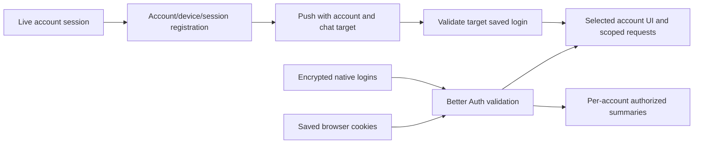
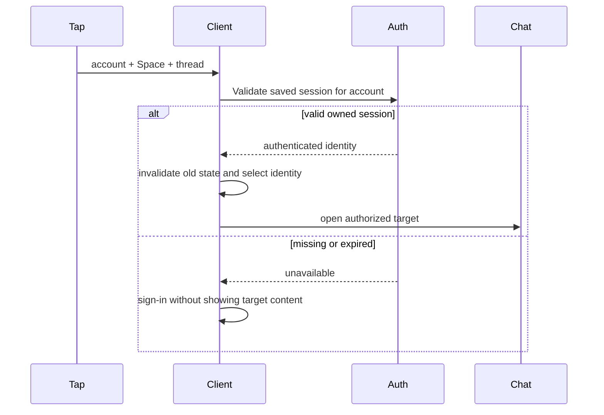
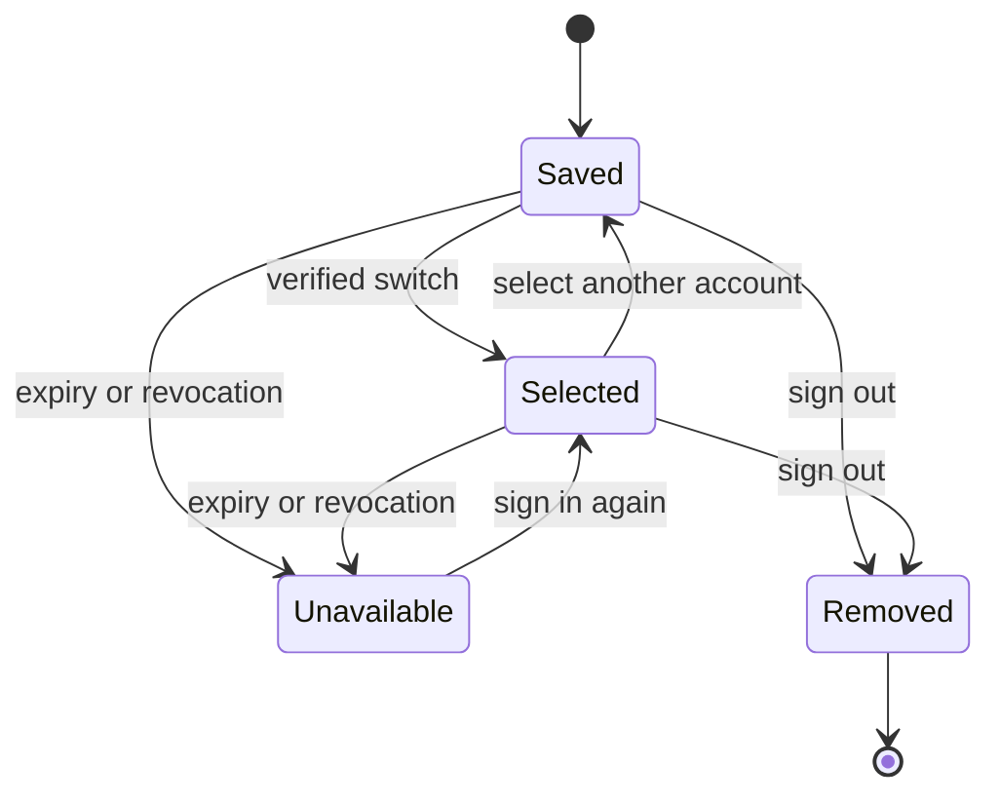

# Switch accounts and receive each account's notifications

## Goal Capsule

**Objective:** People can move between their signed-in Rakazo accounts and receive each account's notifications without mixing private content.
**Means:** Better Auth saved browser sessions, encrypted native saved sessions, and session-bound device registrations.
**Authority:** The approved product behavior and repository AGENTS.md govern this plan. Preserve existing account and Space authorization.
**Execution profile:** One local feature branch with reviewable commits; no push, PR, merge, deployment, live account provisioning, or infrastructure changes. The implementing agent owns verification and the local handoff.
**Stop conditions:** Ask only for a genuine product conflict or an unavailable external prerequisite that prevents meaningful progress. Report verification limits precisely.

## Product Contract

### Summary

Keep multiple accounts signed in, display one identity, and route notifications through the saved session that owns their content.

### Problem Frame

Signing out to change identity interrupts use. A shared phone currently transfers its push token between accounts, so the hidden account loses delivery. Existing notification taps trust whichever identity happens to be selected.

### Requirements

- **R1:** Retain valid saved logins and switch without credentials. The switcher shows selected identity and per-account unread counts.
- **R2:** Deliver notifications for every valid saved account independently of displayed identity and its notification configuration. Every notification identifies its account.
- **R3:** A tap verifies/selects the owning account before opening its Space, bot/group and thread. Missing, expired, revoked or removed logins fail closed and require sign-in; private content never falls back to another identity.
- **R4:** Sign-out removes only this local account session and its registrations. Provide a deliberate sign-out-all path; preserve session revocation and security events.
- **R5:** Preserve isolation of credentials, memberships, caches, in-flight requests, streams, drafts and badges. A browser shares one active identity; other tabs refresh or pause safely.
- **R6:** Existing single-account clients continue working. Migrations allow old/new API overlap and preserve existing registrations.
- **R7:** Apply the coherent feature to web/Electron-hosted UI, mobile session handling, API and delivery. Document platform limits honestly.

### Key Decisions

- **Multiple saved logins, one displayed identity** (session-settled: user-directed — chosen over signing out to switch: the user approved the GitHub Mobile/WhatsApp behavior). Governs R1, R2, R3, R4.
- **One active account per browser** (session-settled: user-directed — chosen over independent tab identities: the user explicitly waived tab independence). Governs R5.

### Acceptance Examples

- **AE1:** Sign in to family@example.test, add work@example.test, switch back without entering credentials, and see each account's unread count.
- **AE2:** While family@example.test is displayed, work@example.test receives a notification on the same registered phone; tapping it opens work@example.test's chat.
- **AE3:** Revoke the hidden account's session. It stops delivery and a stale notification cannot open through the displayed account.
- **AE4:** Sign out one account; the other stays signed in and registered. Sign out all removes all locally saved logins.

### Scope Boundaries

No merging accounts, new memberships, provider presets, hosted requirements, production data or infrastructure changes. No independent identities per browser tab. No new service worker/Web Push transport: browser notifications require a running browser page, as current browser notification support does. Electron shares the web implementation. Do not run desktop Electron E2E locally. Native device acceptance requires an available emulator/device and is reported separately from offline tests.

## Planning Contract

### Baseline and Sources

Fetched origin/main is ba5574b0a35e3ece1ac219e48dd61d59ab6a1875. Reported deployment de8b7a890e4804831baa5b57e276a09a4f191981 is its ancestor. This patch is based on current main, not a deployment patch; deploying it includes intervening upstream changes. Better Auth is now 1.7.15, with no multiSession configured. push_tokens still has userId primary key and globally unique tokenDigest. Repository guidance: AGENTS.md, CLAUDE.md and CONTRIBUTING.md.

- https://better-auth.com/docs/plugins/multi-session
- https://github.com/better-auth/better-auth/blob/v1.7.15/packages/better-auth/src/plugins/multi-session/index.ts
- https://github.blog/changelog/2023-08-15-log-in-with-multiple-github-accounts-on-github-mobile/
- packages/auth/src/index.ts, packages/adapters/src/push-token-store.ts
- apps/web/src/lib/call-session.ts, query.ts, composer-draft.ts
- apps/mobile/lib/session.ts, api.ts, push.ts, open-notification.ts

### Key Technical Decisions

- **KTD1:** Reuse multiSession's signed HttpOnly cookies and session lifecycle. Expose saved account IDs and select/remove by those IDs through an authenticated facade; never return bearer tokens from session-list/read endpoints. Native clients retain signed bearers in SecureStore and validate them with existing get-session.
- **KTD2:** Add a separate push registration table keyed by account, device token digest and session. Keep legacy push_tokens unchanged for old code. Read legacy rows as fallback, deduplicate delivery per account/device, and import/register into the new model. Registration locks the live owned session; session deletion/replacement cleanup targets only that session, including legacy fallback rows so removed registrations cannot reappear. Existing token encryption is retained with account-associated data.
- **KTD3:** Provide a read-only saved-account summary/feed endpoint. Enumerate only cookie-proven live browser sessions (or current bearer session for native clients). Read each user's data through existing authorization, without changing selected cookies. Return identity, unread count and bounded notification targets. Feed IDs identify occurrences, with an initial baseline to avoid replaying old unread items while allowing later replies in already-unread chats. No raw token appears in responses. Select/remove require cookie proof and Better Auth CSRF/origin protection.
- **KTD4:** Reload web after a controlled switch; stop old calls before cookie change. Pin requests to expected user on the server so stale tabs cannot send under a new cookie. Scope drafts by user; ignore unowned legacy drafts instead of assigning them to a newly selected account.
- **KTD5:** Reuse mobile session-generation gates to invalidate caches and late responses on selection. Save account identity and bearer per server. Validate target identity before selection/navigation, never trust payload identity as authorization. Legacy notification targets lacking identity fail closed when multiple accounts are saved; only a sole verified account can accept them. Account-level push settings stay independent. Android's native live poller must either support separate saved identities or pause safely while Expo push continues; never leave it polling the wrong account.

### Assumptions

Unread means unread inbox chats, following existing product badges. Web polling can deliver while its page runs, and mobile background delivery uses existing Expo push. A manual switch discards transient attachments after existing unsaved-work confirmation where applicable; persisted draft text remains account-scoped. Exact endpoint/helper names may change during implementation while preserving these contracts.

### High-Level Technical Design

### Migration and rollback

Add the new registration table with RLS restricted to system operations. Keep old schema/table intact during overlap. Backfill from legacy rows when possible, retaining the same encrypted associated-data identity. New writes do not transfer other users' tokens. Old API instances may still update the old table during the brief overlap; new reads deduplicate and prefer the new model. Rollback retains new table data but old code sees only legacy registrations; multi-account delivery requires the new release. No destructive/deferred drop is needed in this feature. Revoked/expired sessions must be filtered even if cleanup fails.

## Implementation Units

### U1. Saved account authentication and summaries

**Goal:** Establish safe shared server APIs for saved account selection and notifications.
**Requirements:** R1–R6; AE1, AE3, AE4. **Dependencies:** none.
**Files:** packages/auth/src/index.ts; new packages/auth/src/account-sessions.ts and tests; apps/api/src account routes/middleware and tests; shared contracts if needed.
**Approach:** Enable multiSession. Add a server facade that lists proven sessions, selects/removes by non-secret ID, and reads account summaries without changing cookies. Guard stale expected-user requests. Preserve hooks and token redaction.
**Patterns:** Existing identity-confirmation plugin, session hooks, row-security boundaries and unread queries.
**Execution note:** Start with auth integration tests through real handlers; mocks alone do not prove cookie ownership or revocation.
**Test scenarios:**
- Two cookie-authenticated accounts switch without credentials and list no bearer tokens.
- A foreign ID, forged cookie, expired or revoked session cannot be selected or read.
- Removing current session preserves the other; all-session logout removes both and records events.
- Legacy single session/bearer clients still authenticate; expected-user mismatch rejects before mutation.
**Verification:** Real auth handlers and database-backed routing tests prove ownership and session lifecycle; summarize unavailable database checks separately.

### U2. Account/device/session push persistence and delivery

**Goal:** One device receives notifications for multiple valid accounts and multiple sessions remain independently revocable.
**Requirements:** R2, R3, R4, R6; AE2–AE4. **Dependencies:** none; shared identity target contract coordinated with U1.
**Files:** packages/db/prisma/schema.prisma and new migration; packages/db/src/row-security.ts; packages/adapters/src/push-token-store.ts, test-support, postgres tests; expo-push.ts/tests; apps/api/src/routes/account.ts and notification tests.
**Approach:** Implement KTD2, fan out per unique device, account-label all payloads and targets, unregister only registering session, preserve password replacement behavior. Aggregate icon badges over valid accounts sharing a device where practicable; never overwrite with another account's standalone count.
**Test scenarios:**
- Same token under two users survives registration and sends account-specific data to both.
- Two devices for one account both receive; same token/session deduplicates.
- Sign-out/revocation removes only matching session; late registration cannot resurrect a deleted session.
- Password replacement retargets owned registrations; old receipt cannot remove a newly rotated token.
- Old registration migrates/read-falls-back without duplicate sends; encrypted ciphertext never contains raw token.
**Verification:** Offline delivery tests plus real Postgres concurrency/RLS tests and migration inspection.

### U3. Web/Electron account switcher and background notifications

**Goal:** Switch safely through the existing account menu and notify hidden accounts while the browser runs.
**Requirements:** R1–R5, R7; AE1–AE4. **Dependencies:** U1 API contract.
**Files:** apps/web/src/lib/auth.ts, rpc.ts, query.ts, sign-out.ts, composer-draft.ts and tests; App.tsx, SidebarFooter.tsx, shell hooks; new account session/feed helpers and tests; apps/web/e2e/multi-account.spec.ts.
**Approach:** Add saved-account rows, current identity/unread counts, Add account and deliberate sign-out-all. Reuse auth form with add-account mode. Stop calls, guard requests and reload on selection. Consume per-account feed and route notification clicks through verified selection. Remove duplicate selected-thread delivery where the account feed supersedes it.
**Test scenarios:**
- Family/work logins survive add/switch, current row and unread counts are accurate.
- Notification for hidden account selects correct account/Space/chat; unavailable account fails closed.
- Other tab safely reloads/pauses, and stale requests cannot mutate new identity.
- Account A draft never appears in B; sign-out A preserves B draft.
- Real browser test exercises cookie switching, background feed, sign-out-one/all and captures switcher screen.
**Verification:** Focused unit tests, web check/build, existing browser harness when available; layout inspect at desktop/mobile widths.

### U4. Mobile saved sessions and notification account routing

**Goal:** Retain native logins and select the notification owner before rendering its chat.
**Requirements:** R1–R7; AE1–AE4. **Dependencies:** U1/U2 API contracts.
**Files:** apps/mobile/lib/session.ts, api.ts, push.ts, open-notification.ts, notification-open.ts, live-notifications.ts and tests; native auth/settings/account menu routes and thread guards as needed.
**Approach:** Encrypted server-scoped saved account records with legacy-token adoption after verification. Reuse session-generation cache invalidation. Add native account selection/add/sign-out-all. Register push independently without unregistering on mere switch. Handle deep links and cold-start taps with identity validation. Preserve per-account settings and make native Android polling degrade safely if it cannot cover every account.
**Test scenarios:**
- Two saved signed bearers switch without credentials; storage failure fails safely.
- Existing single token is adopted only after verified user identity; endpoints stay isolated.
- Expired/revoked/removed notification target never navigates as another user, including cold start and concurrent taps.
- Sign-out-one/all removes correct logins/registrations; replacement token and in-flight generation gates remain correct.
- Cache, draft, unread and foreground notification suppression stay account-specific.
**Verification:** Focused mobile tests and type check; real push permission/delivery/native UI tests require device availability and are named separately.

## Verification Contract

Use deterministic fictional fixtures and offline default tests. Install pinned workspace dependencies if absent. Run focused auth/API/adapters/mobile/web tests, pnpm check and pnpm lint; run pnpm test where resources permit. Use existing Postgres Testcontainers and Playwright harness for migration/auth/device persistence and actual web journeys when Docker is available. Do not use live provider keys or production endpoints. Do not run Electron E2E. Review staged diff for public data/secrets before every commit. Review finished diff, including migration overlap, rollback, revocation, copy and cross-surface behavior. Record exact commands and outcomes in the local handoff, with no private machine/account details.

## Definition of Done

The behavior in R1–R7 is implemented across applicable surfaces, with focused tests beyond menu mocks. Existing single-account behavior remains covered. Relevant available checks pass; unavailable/failed checks and platform limits are explicit. Remove abandoned approaches and speculative code. Prepare local commits and a handoff identifying baseline/deployed revision relationship, verification, remaining limits and deployment/rollback considerations. Never push or deploy in this task.
